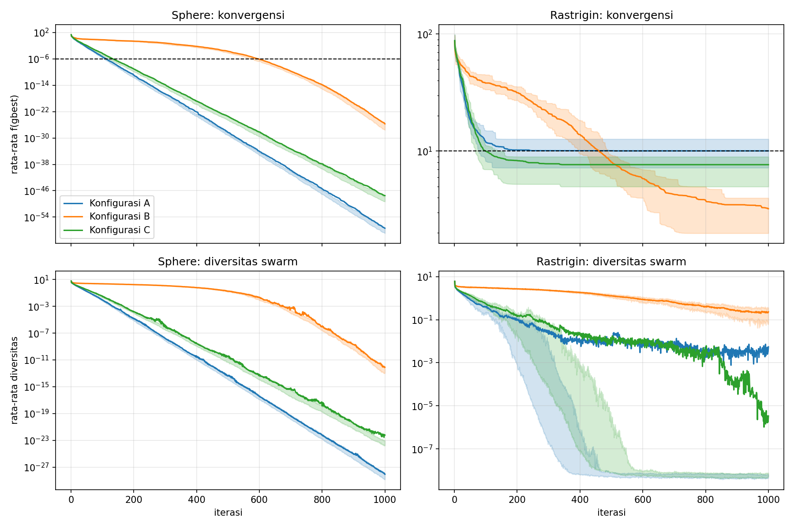
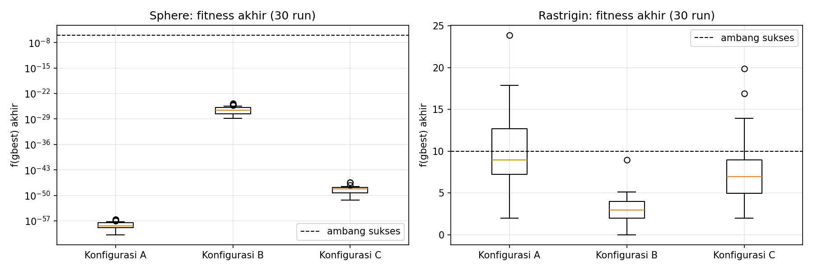
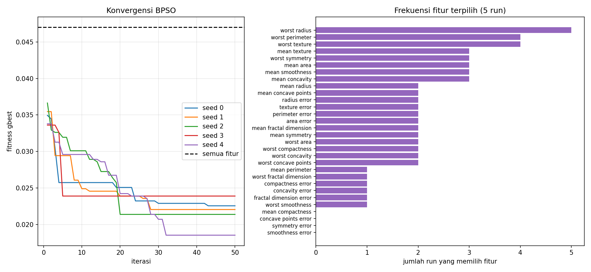

# Implementasi dan Eksperimen PSO

Computational Intelligence — ITS
Maria Putu Evelyne Corena Puryatma (5054251011)

## 1. Pendahuluan

Particle Swarm Optimization (PSO) adalah algoritma optimasi yang terinspirasi dari perilaku kawanan burung (Kennedy & Eberhart, 1995). Setiap partikel bergerak di ruang pencarian dengan dipengaruhi posisi terbaiknya sendiri dan posisi terbaik seluruh kawanan. Hasil PSO sangat tergantung pada parameternya, terutama bagaimana parameter itu menyeimbangkan eksplorasi (mencari di daerah baru) dan eksploitasi (memperbaiki solusi yang sudah ditemukan).

Di tugas ini saya mengimplementasikan gbest PSO dari nol dengan NumPy, lalu membandingkan tiga konfigurasi parameter di fungsi Sphere dan Rastrigin. Sebagai bonus saya juga mencoba Binary PSO untuk seleksi fitur.

## 2. Metode

Update kecepatan dan posisi yang dipakai:

$$v \leftarrow w\,v + c_1 r_1 (pbest - x) + c_2 r_2 (gbest - x), \qquad x \leftarrow x + v$$

dengan $r_1$ dan $r_2$ diambil acak dari $U(0,1)$ untuk setiap partikel, dimensi, dan iterasi. Untuk mode constriction (Clerc & Kennedy, 2002) rumusnya menjadi

$$v \leftarrow \chi\,[\,v + c_1 r_1 (pbest - x) + c_2 r_2 (gbest - x)\,], \qquad \chi = \frac{2}{\left|2 - \varphi - \sqrt{\varphi^2 - 4\varphi}\right|},\quad \varphi = c_1 + c_2$$

Posisi awal diambil acak uniform di [−5,12; 5,12] dan kecepatan awal 0. Kecepatan dibatasi |v| ≤ 2,048 (20% dari lebar ruang). Kalau posisi keluar batas, posisinya dipotong ke batas dan kecepatan di dimensi itu dibuat 0. pbest dan gbest diupdate setelah semua partikel bergerak (update sinkron). Di setiap iterasi saya juga mencatat diversitas swarm, yaitu rata-rata jarak partikel ke titik tengah swarm.

Fungsi uji yang dipakai adalah Sphere, $f(x) = \sum x_i^2$, yang cuma punya satu lembah, dan Rastrigin, $f(x) = 10D + \sum [x_i^2 - 10\cos(2\pi x_i)]$, yang punya banyak minimum lokal. Keduanya memakai D = 10 dan minimumnya f = 0 di x = 0.

Tiga konfigurasi yang dibandingkan:

| Konfigurasi | Parameter |
|---|---|
| A | w = 0,7 tetap, c1 = c2 = 1,5 |
| B | w turun linear dari 0,9 ke 0,4 (Shi & Eberhart, 1998), c1 = c2 = 2,0 |
| C | constriction, χ = 0,7298 (φ = 4,1), c1 = c2 = 2,05 |

Semua konfigurasi memakai 30 partikel, 1000 iterasi, dan 30 run dengan seed 0–29. Seed yang sama dipakai di semua konfigurasi supaya perbandingannya adil. Sebuah run dianggap berhasil kalau fitness akhirnya di bawah 1e-6 untuk Sphere atau di bawah 10 untuk Rastrigin. Perbedaan antar konfigurasi diuji dengan Wilcoxon rank-sum (α = 0,05).

## 3. Hasil

**Tabel 1.** Fitness akhir dari 30 run. Iter. sukses = rata-rata iterasi pertama mencapai ambang (hanya run yang berhasil).

| Fungsi | Konf. | Mean ± Std | Median | Best | Worst | Berhasil | Iter. sukses |
|---|---|---|---|---|---|---|---|
| Sphere | A | 4,25e-58 ± 7,67e-58 | 4,48e-59 | 1,49e-61 | 2,65e-57 | 100% | 109,6 |
| Sphere | B | 1,96e-26 ± 4,25e-26 | 2,25e-27 | 1,56e-29 | 2,04e-25 | 100% | 587,3 |
| Sphere | C | 3,25e-48 ± 8,79e-48 | 5,98e-49 | 5,37e-52 | 3,52e-47 | 100% | 128,9 |
| Rastrigin | A | 10,05 ± 4,89 | 8,96 | 1,99 | 23,88 | 63,3% | 111,8 |
| Rastrigin | B | 3,23 ± 1,77 | 2,98 | 1,0e-11 | 8,96 | 100% | 461,6 |
| Rastrigin | C | 7,66 ± 4,11 | 6,96 | 1,99 | 19,90 | 83,3% | 91,8 |

**Gambar 1.** Atas: rata-rata fitness gbest (skala log). Bawah: rata-rata diversitas swarm. Pita menunjukkan persentil 25–75 dari 30 run.

Di Sphere, A dan C turun hampir lurus di skala log, sedangkan B turun jauh lebih lambat sampai sekitar iterasi 600. Di Rastrigin, A dan C turun cepat ke sekitar 10 lalu hampir datar, sedangkan B terus turun sampai akhir (31,5 → 8,0 → 3,2 di iterasi 200, 500, dan 1000). Diversitas A dan C di Rastrigin jatuh sampai sekitar 5e-9, sedangkan diversitas B masih sekitar 0,2 di iterasi terakhir.

**Gambar 2.** Boxplot fitness akhir dari 30 run (Sphere memakai skala log).

**Tabel 2.** p-value Wilcoxon rank-sum. Konfigurasi dengan median lebih kecil ditulis dalam kurung.

| Fungsi | A vs B | A vs C | B vs C |
|---|---|---|---|
| Sphere | 2,9e-11 (A) | 2,9e-11 (A) | 2,9e-11 (C) |
| Rastrigin | 2,8e-8 (B) | 0,026 (C) | 2,0e-6 (B) |

Semua pasangan berbeda signifikan (p < 0,05). Untuk A vs C di Rastrigin p-nya tipis, dan kalau dikoreksi Bonferroni untuk 3 perbandingan (α ≈ 0,017) hasilnya sudah tidak signifikan.

## 4. Pembahasan

Perbedaan ketiga konfigurasi pada dasarnya soal eksplorasi vs eksploitasi, dan ini kelihatan jelas di grafik diversitas. A (w = 0,7) dan C (efektifnya w ≈ 0,73) langsung eksploitasi dari awal, jadi diversitasnya turun cepat. B mulai dengan w = 0,9 dan c = 2, jadi partikel masih bergerak jauh dan swarm baru mulai mengecil setelah w turun di bawah sekitar 0,6.

Di Sphere tidak ada minimum lokal, jadi makin cepat konvergen makin bagus. Makanya A paling cepat (sampai ambang di iterasi sekitar 110) dan B paling lambat (sekitar 587), walaupun ketiganya tetap berhasil 100%. Di Rastrigin kondisinya kebalik. A dan C kehilangan diversitas terlalu cepat lalu terjebak di minimum lokal. Perbaikan besar terakhir mereka rata-rata terjadi sekitar iterasi 90 dan 111, setelah itu hampir tidak ada perubahan. Nilai akhirnya banyak yang berupa kelipatan sekitar 0,995, karena tiap koordinat yang tersangkut di ±1 menambah kira-kira 0,995 ke fitness. B masih terus membaik sampai sekitar iterasi 618 dan jadi satu-satunya yang berhasil 100%. Jadi tidak ada konfigurasi yang paling bagus untuk kedua fungsi.

Soal A dan C: constriction bisa ditulis ulang jadi PSO inersia dengan w = 0,7298 dan c = 0,7298 × 2,05 ≈ 1,496. Saya cek ini di notebook dan hasilnya memang sama (30 dari 30 run di Rastrigin; di Sphere cuma beda karena pembulatan floating point, p = 0,82). Karena parameter A (w = 0,7, c = 1,5) dekat sekali dengan itu, A dan C memang kelihatan mirip: kurvanya hampir sejajar dan dua-duanya macet di Rastrigin. Tapi angkanya tetap beda signifikan. Di Sphere, w A yang sedikit lebih kecil membuat swarm mengecil sedikit lebih cepat setiap iterasi, dan setelah 1000 iterasi bedanya jadi sekitar 10 orde. Di Rastrigin C sedikit lebih bagus (83% vs 63%) karena diversitasnya bertahan sedikit lebih lama, walaupun bedanya tipis. Jadi dugaan bahwa A dan C mirip benar kalau dilihat dari polanya, tapi tidak sama persis.

Percobaan ini masih punya beberapa keterbatasan. Saya cuma memakai dua fungsi, satu dimensi (D = 10), dan satu setting N dan T. Hasil B juga sangat tergantung T karena jadwal w-nya mengikuti T. Grafik konvergensi memakai rata-rata yang gampang tertarik oleh run ekstrem, makanya saya tambahkan pita persentil dan boxplot. Uji Wilcoxon juga belum dikoreksi untuk perbandingan berganda.

## 5. Kesimpulan

PSO berhasil diimplementasikan dari nol dengan NumPy. Di Sphere semua konfigurasi berhasil 100%, dengan A paling cepat. Di Rastrigin B paling bagus dan paling konsisten (mean 3,23, berhasil 100%), sedangkan A dan C terjebak di minimum lokal (63% dan 83%). Dari grafik diversitas kelihatan bahwa eksplorasi di awal penting untuk fungsi multimodal, sedangkan untuk fungsi unimodal lebih baik cepat konvergen. C memang setara dengan inersia w = 0,7298 dan c ≈ 1,496, tapi A dan C tetap beda signifikan walaupun polanya mirip.

## 6. Bonus: Binary PSO untuk seleksi fitur

Dataset Breast Cancer Wisconsin (569 sampel, 30 fitur) saya bagi jadi 80% data latih dan 20% data uji. Binary PSO (Kennedy & Eberhart, 1997) memakai update kecepatan yang sama dengan w = 1, c1 = c2 = 2, dan Vmax = 4, lalu bit jadi 1 kalau angka acak < sigmoid(v). Fitness yang diminimalkan adalah 0,99 × (1 − akurasi CV) + 0,01 × (jumlah fitur / 30), dengan akurasi CV dari KNN (k = 5) dan 5-fold stratified CV. Parameter yang dipakai N = 20, T = 50, dan 5 run. Data uji tidak dipakai sama sekali selama seleksi.

**Tabel 3.** Semua fitur vs hasil BPSO (rata-rata 5 run).

| Subset | Jumlah fitur | Akurasi CV (latih) | Akurasi uji |
|---|---|---|---|
| Semua fitur | 30 | 96,3% | 95,6% |
| BPSO | 11,6 (9–14) | 98,2% | 94,7% |

**Gambar 3.** Kiri: konvergensi BPSO. Kanan: berapa kali tiap fitur terpilih dari 5 run.

BPSO bisa mengurangi fitur dari 30 ke sekitar 12. Akurasi CV di data latih naik, tapi akurasi di data uji tidak ikut naik (bedanya cuma 1–2 sampel dari 114). Ini karena subset fiturnya dipilih untuk memaksimalkan akurasi CV itu sendiri, jadi angka CV-nya terlalu optimis. Dari data uji, akurasinya bisa dibilang hampir sama padahal fiturnya kurang dari setengah. Fitur yang paling sering terpilih adalah worst radius (5 dari 5 run), worst perimeter, dan worst texture (4 dari 5), yaitu ukuran dan tekstur inti sel yang paling abnormal. Dengan cuma 5 run dan 50 iterasi, hasil ini masih perlu dicek dengan percobaan yang lebih banyak.

## Referensi

1. Kennedy, J., & Eberhart, R. (1995). Particle swarm optimization. *Proceedings of ICNN'95 — International Conference on Neural Networks*, 4, 1942–1948.
2. Shi, Y., & Eberhart, R. (1998). A modified particle swarm optimizer. *1998 IEEE International Conference on Evolutionary Computation Proceedings*, 69–73.
3. Clerc, M., & Kennedy, J. (2002). The particle swarm — explosion, stability, and convergence in a multidimensional complex space. *IEEE Transactions on Evolutionary Computation*, 6(1), 58–73.
4. Kennedy, J., & Eberhart, R. C. (1997). A discrete binary version of the particle swarm algorithm. *1997 IEEE International Conference on Systems, Man, and Cybernetics*, 5, 4104–4108.
5. Wolberg, W., Mangasarian, O., Street, N., & Street, W. (1995). *Breast Cancer Wisconsin (Diagnostic)* [Dataset]. UCI Machine Learning Repository. https://doi.org/10.24432/C5DW2B
